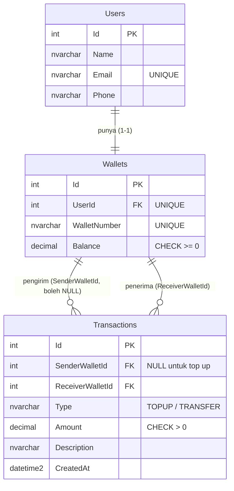
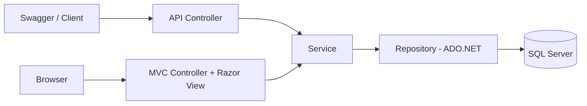

# Koda E-Wallet (Weekly 5)

Lanjutan Weekly 4 console menjadi aplikasi ASP.NET Core yg punya REST API dan halaman web (MVC).
Data disimpan di SQL Server memakai ADO.NET (`Microsoft.Data.SqlClient`, tanpa EF Core).

## **Fitur**

- Kelola pengguna (lihat, tambah, ubah). User baru otomatis punya wallet saldo Rp0.
- Info wallet: nomor wallet, pemilik, saldo, total pemasukan dan pengeluaran
- Top up (nominal harus lebih dari 0, dicatat ke database)
- Transfer antar wallet (validasi penerima, nominal, diri sendiri, saldo kurang)
- Riwayat transaksi dengan filter pemasukan / pengeluaran dan total transaksi
- Swagger UI untuk dokumentasi API, global error handling

## ERD



Pemasukan = wallet sebagai penerima, pengeluaran = wallet sebagai pengirim.
Index: `IX_Transactions_SenderWalletId` dan `IX_Transactions_ReceiverWalletId` untuk mempercepat riwayat per wallet.

## Alur API dan MVC

Keduanya memakai Service dan Repository yang sama lewat Dependency Injection, jadi aturan bisnis tidak ditulis dua kali.



Alur transfer di halaman web:

1. Form transfer (nomor wallet tujuan, nominal, catatan)
2. `Transfer` (POST) -> `ValidateTransferAsync` -> tampil halaman konfirmasi (belum ada data yang berubah)
3. `ConfirmTransfer` (POST) -> `TransferAsync` -> redirect ke Dashboard dengan pesan sukses

Atomic transfer: `TransactionRepository.TransferAsync` memakai satu `SqlTransaction`
(kurangi saldo pengirim -> tambah saldo penerima -> catat transaksi -> `Commit`, dan `Commit`di akhir jadi jika ada langkah yang gagal, transaction tidak di-commit sehingga otomatis di-rollback).
saldo dan riwayat tidak berubah.

## Daftar Endpoint

| Method | Endpoint | Keterangan |
|---|---|---|
| GET | `/api/users` | Semua user |
| GET | `/api/users/{id}` | Detail user |
| POST | `/api/users` | Buat user + wallet (saldo Rp0) |
| PUT | `/api/users/{id}` | Ubah user |
| GET | `/api/wallets/{userId}` | Info wallet |
| POST | `/api/wallets/{userId}/topups` | Top up |
| POST | `/api/transfers` | Transfer (body: `senderUserId`, `receiverWalletNumber`, `amount`, `description`) |
| GET | `/api/users/{id}/transactions?filter=All\|Income\|Expense` | Riwayat transaksi |

Status code error (format JSON ProblemDetails, dari `GlobalExceptionHandler`):

| Kasus | Status |
|---|---|
| Input tidak valid (Data Annotation, nominal <= 0, transfer ke diri sendiri) | 400 |
| User / wallet tidak ditemukan | 404 |
| Email sudah dipakai | 409 |
| Saldo tidak mencukupi | 422 |
| Error database / server | 500 |

Halaman web: `/` (pilih user), `/Wallet/Dashboard/{userId}`, `/Wallet/TopUp/{userId}`, `/Wallet/Transfer/{userId}`, `/Wallet/History/{userId}`.

## Cara Menjalankan

Butuh: .NET SDK 10 dan SQL Server.

1. Siapkan SQL Server dan tambahkan pada setting.json :
   ```
   "ConnectionStrings": {
    "Default": "Server=localhost;Database=KodaEWallet;User Id=sa;Password=YourPassw0rd123;TrustServerCertificate=True"
  }
   ```
2. Buat database dan data dummy: jalankan `Database/schema.sql` (Postgres/ MSSQL).

3. Jalankan:
   ```
   dotnet run --project KodaEWallet
   ```
5. Buka `http://localhost:<port>` (web) dan `http://localhost:<port>/swagger` (Swagger UI).

## Data Dummy

| Wallet | Nama | Saldo |
|---|---|---|
| WAL001 | Andi | Rp500.000 |
| WAL002 | Budi | Rp350.000 |
| WAL003 | Citra | Rp350.000 |

## Hasil Testing

Isi kolom hasil setelah menjalankan skenario di Swagger / halaman web.

| No | Skenario | Yang diharapkan | Hasil |
|---|---|---|---|
| 1 | GET `/api/users` | 200, 3 user | |
| 2 | POST `/api/users` data valid | 201, wallet baru saldo 0 | |
| 3 | POST `/api/users` email sudah ada | 409 | |
| 4 | PUT `/api/users/{id}` | 200, data berubah | |
| 5 | GET `/api/wallets/1` | 200, saldo 500000, income 500000, expense 0 | |
| 6 | Top up 100000 | 200, saldo bertambah, masuk riwayat | |
| 7 | Top up 0 / minus | 400 | |
| 8 | Transfer valid (WAL001 -> WAL002) | 200, saldo kedua wallet berubah | |
| 9 | Transfer ke wallet tidak ada | 404 | |
| 10 | Transfer ke diri sendiri | 400 | |
| 11 | Transfer nominal 0 / minus | 400 | |
| 12 | Transfer melebihi saldo | 422, saldo dan riwayat tidak berubah | |
| 13 | Riwayat filter Income / Expense | hanya transaksi sesuai filter, total benar | |
| 14 | Halaman web: dashboard, top up, transfer + konfirmasi, riwayat | berjalan sesuai skenario di atas | |

## Screenshot

Simpan di folder `screenshots/` lalu tampilkan di sini:

- [Swagger / API testing](Screenshots/swagger.png) 
- [Razor Dashboard](Screenshots/dashboard.png)
- [Top Up](Screenshots/topup.png)
- [Transfer](Screenshots/transfer.png)
- [Transaction History](Screenshots/transaction-history.png)
